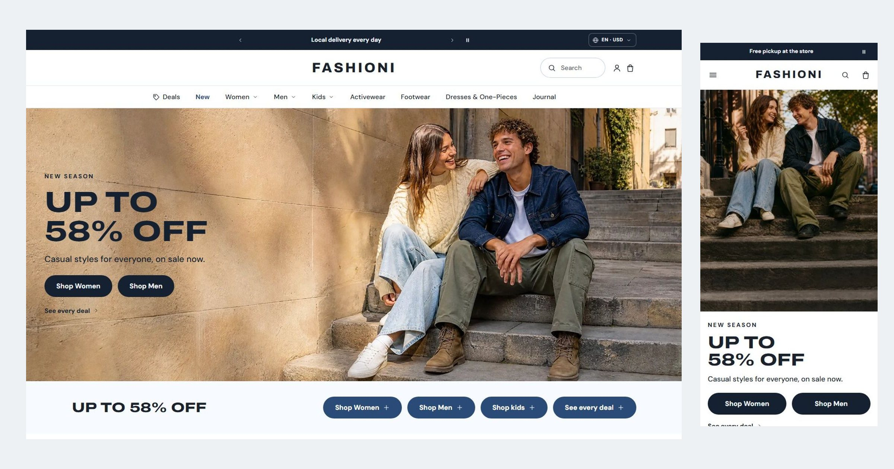
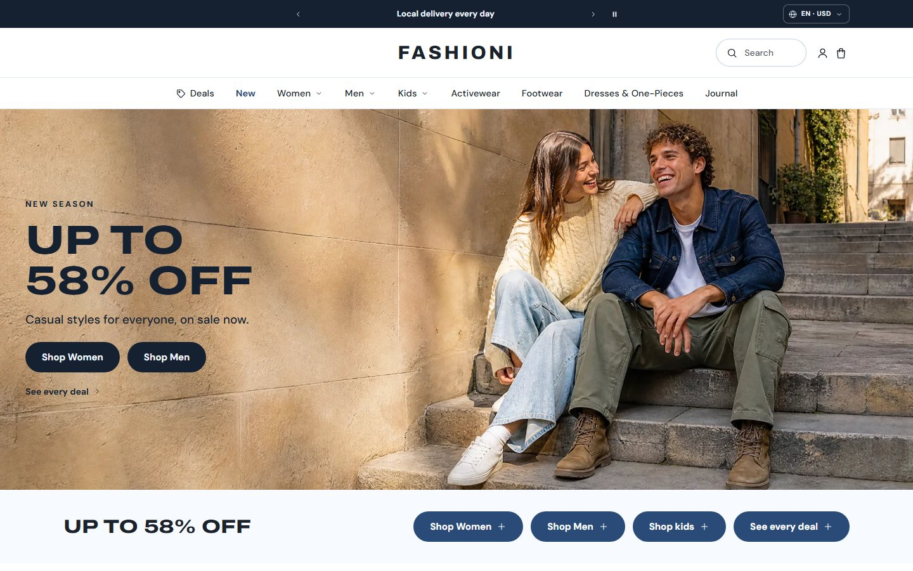
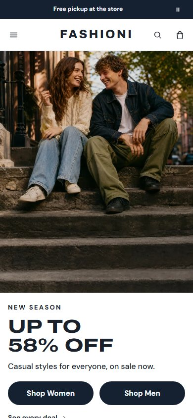
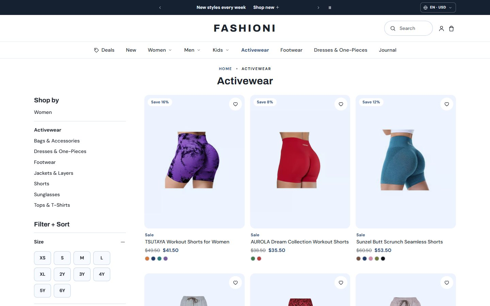
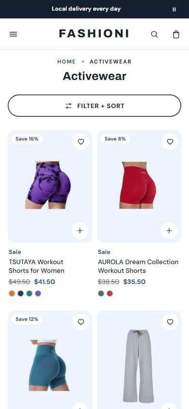
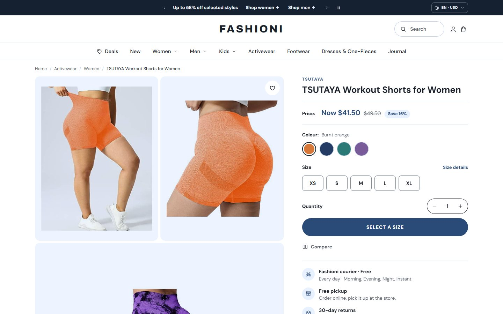
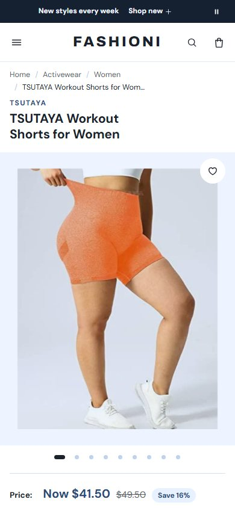
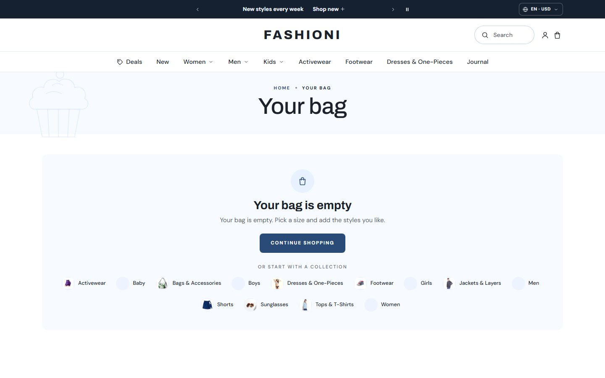
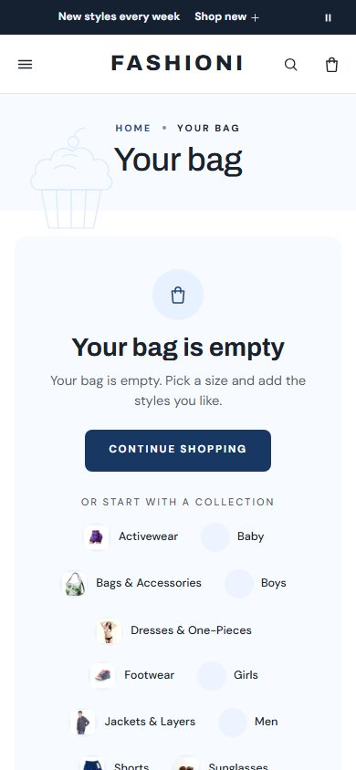

<p align="center">
  
</p>

<h1 align="center">Denimo Casual Fashion</h1>

<p align="center">
  <b>Casual clothing, denim first.</b><br>
  A custom Selldone Layout built on the official <a href="https://github.com/selldone/storefront">selldone/storefront</a>.
</p>

<p align="center">
  <a href="https://denimo.selldone.shop"></a>
  <a href="https://github.com/selldone-custom-layouts/official-denimo/wiki"></a>
  <a href="https://github.com/selldone-custom-layouts/official-denimo/wiki/Install-with-AI"></a>
  
  
  
</p>

<p align="center">
  <a href="https://denimo.selldone.shop"><b>Open the live shop</b></a> ·
  <a href="https://github.com/selldone-custom-layouts/official-denimo/wiki/Install-with-AI">Set it up with AI</a> ·
  <a href="https://github.com/selldone-custom-layouts/official-denimo/wiki/Manual-Setup">Manual setup</a> ·
  <a href="https://github.com/selldone-custom-layouts/official-denimo/wiki/Shop-Requirements">What your shop needs</a> ·
  <a href="https://github.com/selldone-custom-layouts">All Selldone custom layouts</a>
</p>

---

## What it is

**Denimo Casual Fashion** — Casual denim-first fashion: promo bar, mega menus by audience, campaign hero, split and wide banners, category and audience tiles, rails, quick-add cards, colour circles and size chips.

- **one colour family**: the palette's hue gives every ground (the white page, its soft tint bands, the plates, the lines, the words, the dark top bar and footer) and the one action colour (Denim `#2a4a78` by default), so a palette or a custom colour re-tints the whole page;
- Archivo for headings, the wordmark and numbers set large, over DM Sans for reading, buttons and the nav;
- **one shape language**: circles for round things, 14 px panels and photos, 8 px inner parts; square only where a band meets the window's edge; focus rings inside the box, one per control;
- photography in every slot (the shop's own photos, with designed fallbacks drawn from the shop's own products);
- flat buttons, hover changes the colour only, no line under any word or icon;
- light by default, with the other mode in the same family; a **Theme** row in the footer on the showcase shop: Denim, Rust, Olive, Charcoal, Berry, a **Custom colour** and Light / Dark;
- it says **bag**; every word it writes is in English and Arabic (right to left).

It runs on **[denimo.selldone.shop](https://denimo.selldone.shop)**, one domain of the Selldone shop Fashioni (Selldone lets each domain of a shop carry its own Layout; the shop's default and its other domains keep theirs).

Everything is read live from the shop: its title (drawn as the wordmark), collections, products, prices and savings, delivery ways with their days, fees and time windows, the pickup point and its hours, the way to pay, the articles. Nothing about Fashioni is written in the code, so another shop that imports the Layout gets its own data. Selldone's own bag, checkout, payments and orders keep working underneath.

## The home

| # | Section | Variant | What it shows |
| --- | --- | --- | --- |
| 1 | `hero` | `campaign` | The `hero` photo to the frame's edges, the biggest saving in big words on its calm side, a capsule per audience; on a phone the `hero-phone` portrait with the words under it. |
| 2 | `offerband` | `band` | The live saving on a tint band, with a capsule + per audience on sale. |
| 3 | `tiles` | `categories` | Shop by category: every department with products as 3:4 tiles in one scrolling row. |
| 4 | `split` | `two-up` | Two portrait banners of the departments that have a `split-<slug>` photo. |
| 5 | `rail` | `trending` | Trending now: best sellers, departments mixed, one scrolling row of cards. |
| 6 | `wide` | `a` | A wide banner: the first department that has a `wide-<slug>` photo, the words on the photo's calm side. |
| 7 | `rail` | `sale` | On sale now: one row of cards, the biggest saving first. |
| 8 | `tiles` | `audiences` | Shop for everyone: Women, Men, Girls, Boys, Baby (those with products) as tiles; circles on a phone. |
| 9 | `wide` | `b` | A second wide banner, for the second such department. |
| 10 | `rail` | `new` | New arrivals: one row of cards, the newest first. |
| 11 | `services` | `cards` | Three service cards from the shop's facts (pickup, delivery, returns or payment). |
| 12 | `journal` | `photo` | The four newest posts beside the tall `journal` photo with the big word 'Journal'. |

A section the shop has no data for hides itself; tint bands alternate with white.

## Screenshots

| Desktop | Phone |
| --- | --- |
|  |  |
|  |  |
|  |  |
|  |  |

Take them from the live shop once it is pinned: `node --use-system-ca scripts/doc-shots.cjs` (through `new-shop-kits/pw-lock.sh`).

## Tests

Every check runs one browser at a time against the shop, at 1440px, 1024px and 390px, dark and light, every palette and the custom colours #ffff00, #00ffff and #111111, and Arabic (right to left). Each is delivered at **TOTAL 0**.

<!-- TESTS:START -->
On the live domain (https://denimo.selldone.shop), 16 November 2026:

| Check | 1.0.0 (first run) | 1.0.1 | 1.0.2 / 1.0.3 |
| --- | --- | --- | --- |
| ring, card-edge, corner, circle, underline | 0 | 0 | 0 |
| cart, currency | 0 | 0 | 0 |
| contrast (5 palettes, custom colours, dark, Arabic) | 32 | 0 | 0 |
| shape (14 / 8 px scale, focus corners) | 400 | 0 | 0 |
| text-col, box | 7 | 0 | 0 |
| i18n (Arabic) | 6 | 2 (the shop's spec titles) | 0 |

Before each upload, `scripts/release.sh` step 5b loaded the production bundle through the live shop's own HTML (PROD-CHECK OK), and the server's copy matched the build (js and css). The guest checkout walk (`scripts/checkout-walk.mjs`, 1.0.4, desktop 1440 and phone 390) runs as a guest from a size and Add to bag through the bag drawer, contact, the address sheet (map, pin, details) and every delivery method the shop offers, up to Selldone's payment window, and closes it there: with a local address the shop's courier, a delivery window, and "Place order · pay on delivery" open the window with the same total (cash on delivery). A product whose package is over the courier's size limit gets the "No delivery method reaches this bag yet" card instead, with no Place order. No order is placed, and the bag is emptied at the end.
<!-- TESTS:END -->

## Photos

| Slot | File | Size | In the build |
| --- | --- | --- | --- |
| hero | `skins/denimo/photos/hero.webp` | 2400 × 1000 | yes |
| hero-phone | `skins/denimo/photos/hero-phone.webp` | 1080 × 1350 | yes |
| footer | `skins/denimo/photos/footer.webp` | 2400 × 800 | yes |
| aud-women | `skins/denimo/photos/aud-women.webp` | 900 × 1200 | yes |
| aud-men | `skins/denimo/photos/aud-men.webp` | 900 × 1200 | yes |
| aud-girls | `skins/denimo/photos/aud-girls.webp` | 900 × 1200 | yes |
| aud-boys | `skins/denimo/photos/aud-boys.webp` | 900 × 1200 | yes |
| aud-baby | `skins/denimo/photos/aud-baby.webp` | 900 × 1200 | yes |
| split-tops-t-shirts | `skins/denimo/photos/split-tops-t-shirts.webp` | 1200 × 1500 | yes |
| split-activewear | `skins/denimo/photos/split-activewear.webp` | 1200 × 1500 | yes |
| wide-dresses-one-pieces | `skins/denimo/photos/wide-dresses-one-pieces.webp` | 2400 × 1000 | yes |
| wide-dresses-one-pieces-phone | `skins/denimo/photos/wide-dresses-one-pieces-phone.webp` | 860 × 1075 | yes |
| wide-footwear | `skins/denimo/photos/wide-footwear.webp` | 2400 × 1000 | yes |
| wide-footwear-phone | `skins/denimo/photos/wide-footwear-phone.webp` | 860 × 1075 | yes |
| journal | `skins/denimo/photos/journal.webp` | 1200 × 1400 | yes |
| each collection | `skins/denimo/photos/col-<slug of its title>.webp` | 900 × 1200 | 8 file(s); a collection without one shows its best sellers on a plate |

## Use it on your shop

| You want to… | Read |
| --- | --- |
| Let an AI agent (Claude Code, Codex…) set it up for your shop | [Install with AI](https://github.com/selldone-custom-layouts/official-denimo/wiki/Install-with-AI) |
| Do it yourself, step by step | [Manual Setup](https://github.com/selldone-custom-layouts/official-denimo/wiki/Manual-Setup) |
| Know what data your shop needs for the design to look right | [Shop Requirements](https://github.com/selldone-custom-layouts/official-denimo/wiki/Shop-Requirements) |
| Build, upload and verify a release | [Build and Upload](https://github.com/selldone-custom-layouts/official-denimo/wiki/Build-and-Upload) |
| Put the Layout live on your shop, or on one domain of it | [Go Live](https://github.com/selldone-custom-layouts/official-denimo/wiki/Go-Live) |
| Change the name, sections, pages, photos or languages | [Customize](https://github.com/selldone-custom-layouts/official-denimo/wiki/Customize) |
| Change the colours, dark or light, the visitor switcher | [Theme and colours](https://github.com/selldone-custom-layouts/official-denimo/wiki/Theme-and-colours) |
| Fix a blank page, a rejected upload or an old version showing | [Troubleshooting](https://github.com/selldone-custom-layouts/official-denimo/wiki/Troubleshooting) |

## Quick start (developers)

```bash
git clone https://github.com/selldone-custom-layouts/official-denimo.git
cd official-denimo
npm run setup            # the six Selldone modules (modules/)
for p in components translate; do git -C modules/$p apply ../../patches/modules-$p.kalio.patch; done
npm install --force
npm run serve            # dev server on http://localhost:9170, reading the shop named in .env
```

The skin is `skins/denimo/skin.json` (names, palettes, fonts, radius, wordmark, basket word, home sections, photo slots, loading screen) with its photos in `skins/denimo/photos/`; after a change run `node scripts/skin-apply.mjs`. Releases:

```bash
LAYOUT_ID=<your Layout id> SELLDONE_CLI_SRC=<cli clone> bash scripts/release.sh <new version> desk
```

Leave `LAYOUT_ID` out on the first upload; use the id printed after it from then on. Never reuse a version number. Keep the build at 300 files or fewer (the release script prints the count).

## Where things are

| Area | Files |
| --- | --- |
| The skin (the only file that makes this Layout this Layout) | [`skins/denimo/skin.json`](skins/denimo/skin.json), photos in `skins/denimo/photos/` |
| Generated from the skin (never edit) | `components/ly/skin.gen.ts`, `style/ly-skin.gen.scss`, `manifest.json`, `selldone-layout.json`, `.env`, `scripts/loading/config.json`, `checks/` |
| Your theme (palette, brand colour, mode, switcher) | [`components/ly/ly-theme.settings.ts`](components/ly/ly-theme.settings.ts) |
| The colour family | [`components/ly/ly-family-core.ts`](components/ly/ly-family-core.ts) (maths), [`ly-family.ts`](components/ly/ly-family.ts) (painting) |
| The look | [`style/ly/`](style/ly/) (`base.css`, `pages.css`, `look.css`, `variants.css`), [`style/ly-layout.scss`](style/ly-layout.scss), [`style/ly-sd.scss`](style/ly-sd.scss) |
| Header, bag drawer, footer, splash | [`components/ly/shell/`](components/ly/shell/) |
| Home and its sections | [`components/ly/home/`](components/ly/home/) (`LyHome.vue`, `sections.json`, `sections/`) |
| Words (English and Arabic) | [`components/kalio/i18n/ly.en.ts`](components/kalio/i18n/ly.en.ts), [`ly.ar.ts`](components/kalio/i18n/ly.ar.ts); the skin's own words in `skin.json` "words" |
| Release notes, Layout id, checks of each version | [`LAYOUT.md`](LAYOUT.md) |
| The base this Layout is a skin of | [`BASE.md`](BASE.md) |
| Checks and release tooling | [`scripts/`](scripts/) (`run-checks.sh`, `fast-checks.config.mjs`, `release.sh`, `prod-check.mjs`, `checkout-walk.mjs`, `publish-github.sh`) |
| Selldone storefront's original README | [`README.selldone.md`](README.selldone.md) |

## Credits and license

Built on the official [Selldone Storefront](https://github.com/selldone/storefront) (MIT License, © Selldone); see [`LICENSE.md`](LICENSE.md). Photos: see `skins/denimo/photos/` and their licence notes in `LAYOUT.md`. Part of **[Selldone Custom Layouts](https://github.com/selldone-custom-layouts)**.
