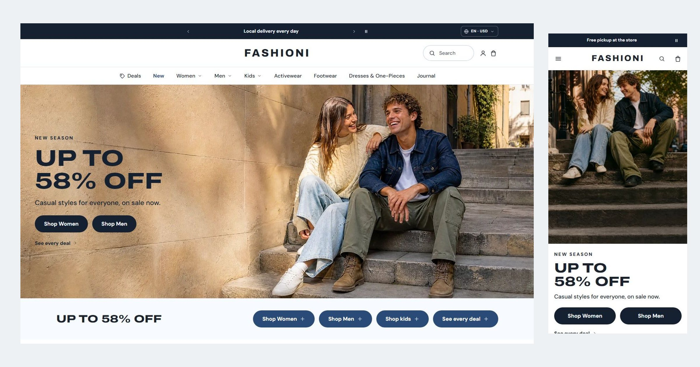
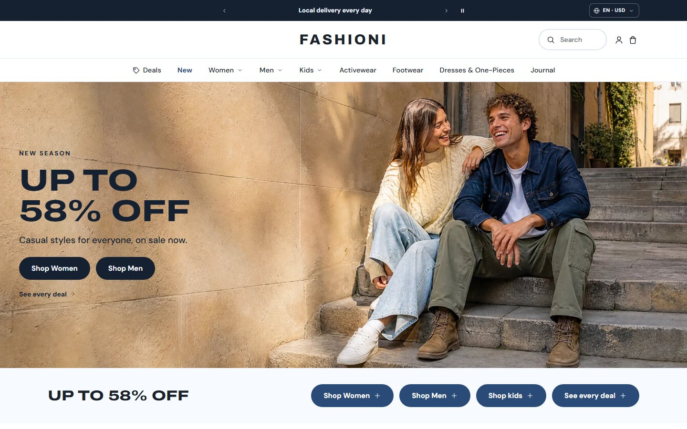
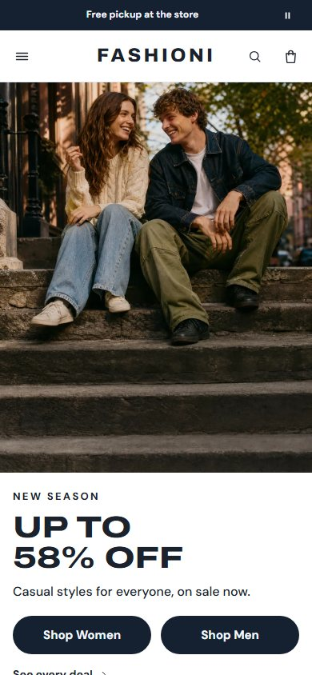
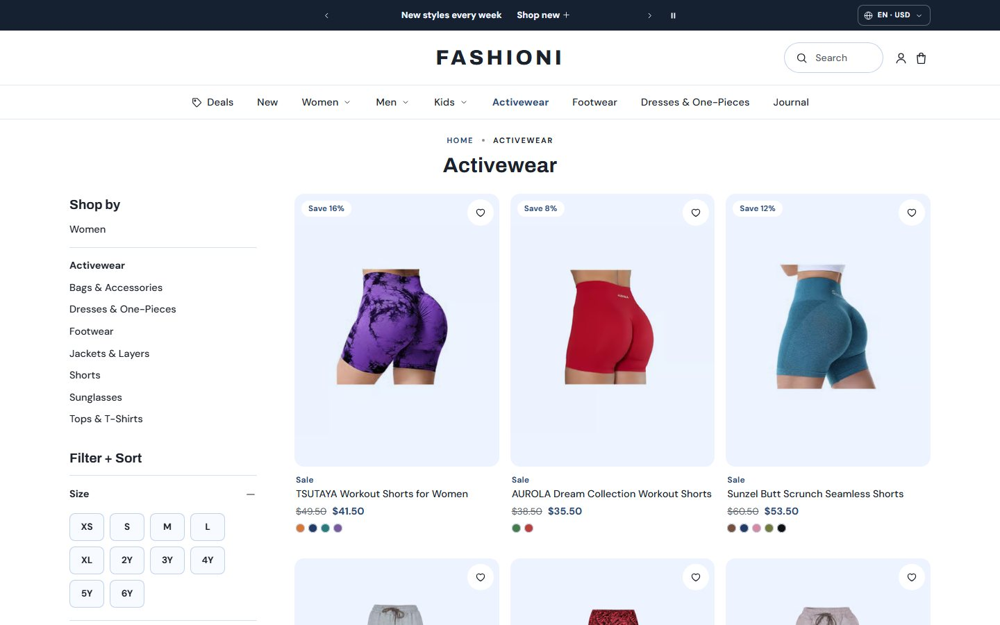
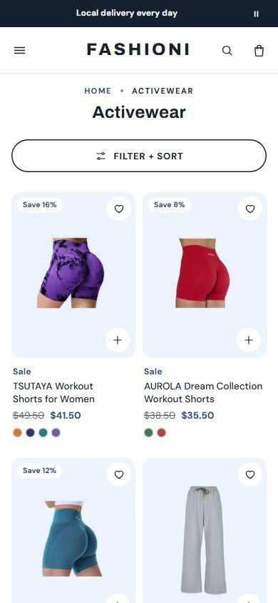
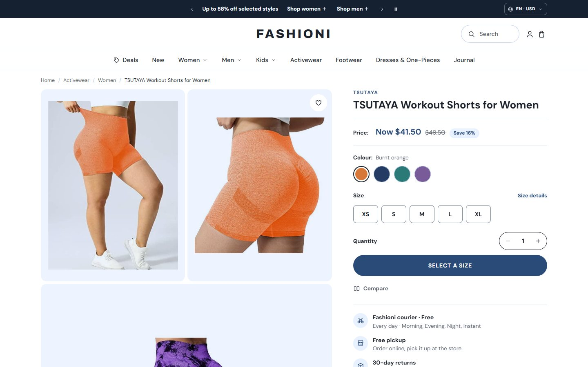
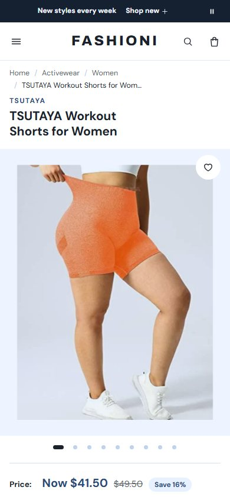
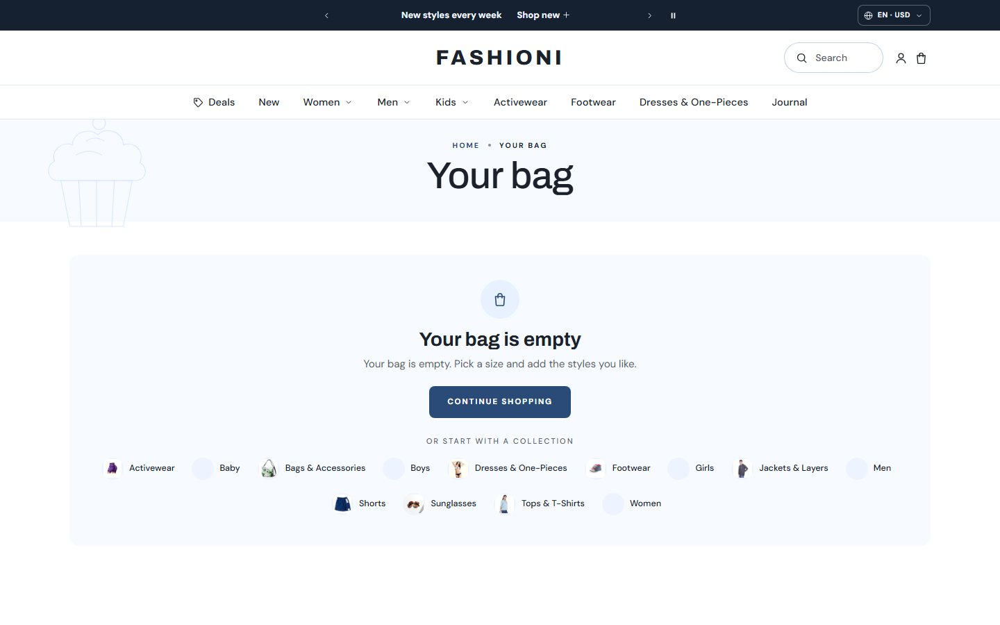
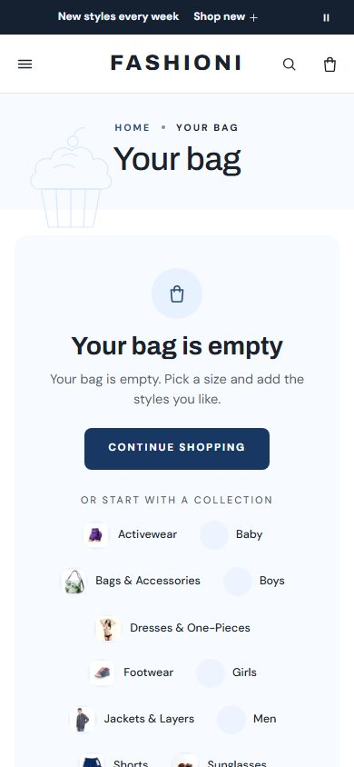

# Denimo Casual Fashion

**Denimo Casual Fashion** is a custom storefront **Layout** for Selldone shops: a casual clothing shop laid out like a big American mall brand (the page structure only, never another brand's name, logo, photos or words). A family-dark promo bar, the shop's name as a centred uppercase wordmark with a search pill, a department row whose audiences (Women, Men, Kids) open full-width mega menus, a full-bleed campaign photo, portrait and wide banners, category and audience tiles, one-line product rails, and a category page and product page built for sizes and colours.

It runs on **[denimo.selldone.shop](https://denimo.selldone.shop)**, one domain of the Selldone shop Fashioni. The shop's default address and its other domains carry other Layouts; Denimo is pinned on its own domain only (see [Go Live](Go-Live)). It is built on the official [selldone/storefront](https://github.com/selldone/storefront), so Selldone's basket, checkout, payments and orders keep working underneath a new design.

## Start here

| I want to… | Page |
| --- | --- |
| Have an AI agent set it up on my shop | **[Install with AI](Install-with-AI)** |
| Set it up myself | [Manual Setup](Manual-Setup) |
| Know what my shop's data needs | [Shop Requirements](Shop-Requirements) |
| Build, upload and verify a release | [Build and Upload](Build-and-Upload) |
| Put it live on my shop or one domain | [Go Live](Go-Live) |
| Change the name, sections, pages, photos, languages | [Customize](Customize) |
| Change the colours, dark or light, the visitor switcher | [Theme and colours](Theme-and-colours) |
| Fix a problem | [Troubleshooting](Troubleshooting) |

## How a Selldone Layout works (one minute)

1. A **Layout** is a complete storefront app (Vue 3) that runs on Selldone's own servers instead of the default storefront.
2. You build it, zip it, and **upload** it to your Selldone developer account with the official [selldone-cli](https://github.com/selldone/cli). Each upload is a new **version**.
3. You **attach** a version to your shop, or to one domain of it.
4. Selldone injects **your** shop into the Layout: its title, collections, products, prices, delivery ways, payment methods, articles, languages, currencies and settings. Nothing about Fashioni is hard-coded: not the name (the wordmark is your shop's title), not a price, a delivery window or an opening hour. The only shop-specific files are the photos in `skins/denimo/photos/`; without them every photo slot shows its fallback (the family colour or your own products; a banner without its photo is left out). Another shop that imports the Layout gets its own data.

## The look

| Part | Denimo |
| --- | --- |
| Grounds | a white page `#ffffff` with soft tint bands and cards `#f7faff`, plates `#edf4ff`, a deeper tint `#d7e8ff`, near-black ink `#1c222b`, muted words `#575e69`, lines `#d6e1f1`; a dark top bar and footer in the family's darkest shade `#152030` with words `#f2f7ff`. These are the Denim values: with another palette or a custom colour every one of them takes that colour's hue |
| Action colour | Denim `#2a4a78` (white words 8.94:1) on every button, chosen state and link; on the dark top bar and footer the family's light shade (`--ly-act-dk`, `#87ace0`) marks the hover |
| Products | the product's photo contained on a tinted 3:4 plate, a small "Save n%" chip when there is a saving, colour dots under the name |
| Type and icons | Archivo for headings, the wordmark and numbers set large; DM Sans for reading, and in spaced capitals for eyebrows, buttons, the nav and the top bar; inline line icons; the mockup's line drawings of products (line drawings kept from the base; Denimo uses none), faint in the title bands and in the photo slots' fallbacks |
| Shapes | one shape language: round for round things (a circle for icon buttons, the ♡ and + on a card, the colour circles, the mark, the map pin; a capsule for the hero's and banners' buttons, Add to bag and the "Save n%" chip), 14 px for panels and photos, 8 px for inner parts (size chips, fields, plates, thumbnails); square only where a band meets the window's edge |
| Buttons | flat; hover changes the colour only; no line under any word or icon (the one exception is a link inside a post's own text); selection rings inside the box |
| Photos | the photo slots (the campaign hero and its phone crop, a portrait banner or a wide banner and its phone crop per department, one tile per audience, the journal, the footer's texture) and one photo per department: your own photo when the Layout has one, else a fallback (the family colour, your own products on a plate, or, for a banner, no banner); never a caption or a file name |
| Theme | light by default; the other mode in the same family (for Denim: page `#0c1015`, cards `#161c24`, words `#eaf1fa`, links `#8eb3e8`); five palettes (Denim, Rust, Olive, Charcoal, Berry) and a custom colour, each re-tinting the whole page; a visitor switcher (a footer row) on the showcase shop only (see [Theme and colours](Theme-and-colours)) |
| Languages | English and Arabic (right to left); the language and currency pill in the top bar |

## What you get

- **Header:** a family-dark promo bar that turns through up to four messages from the shop's own data (the biggest saving with "Shop women +" / "Shop men +", free pickup, the local delivery days, returns when the products say so, new styles) with ‹ ›, pause, and no motion for visitors who ask for less, and the language and currency pill at its end; the wordmark row (the wordmark centred, a search pill with live suggestions, the account and the bag); the department row: **Deals**, **New**, **Women / Men / Kids** (click to open a full-width mega menu: Featured, Clothing, Shoes & accessories, two photo tiles), the biggest departments and the Journal. On a phone: the menu button, the wordmark, search and the bag; the menu lists the audiences with their photos, then the departments (six, then "Show N more").
- **Audiences without audience categories:** many clothing shops keep Women / Men / Girls / Boys / Baby as empty folders and file products by type. Denimo reads a product's audience from its tags (`women`, `men`, `girls`, `boys`, `baby`, `kids`, `unisex`), else from its title, else from a spec "Department"; `?aud=women` filters any listing, and an empty audience folder opens its audience's products.
- **Home,** in this order (a section without its data hides itself):
  1. **Campaign hero:** the `hero` photo to the frame's edges with the biggest saving set large ("Up to 58% off") on its calm side and a capsule per audience; on a phone the `hero-phone` portrait with the words under it;
  2. **Offer band** on a tint band: the saving and a capsule with + per audience on sale;
  3. **Shop by category:** every department with products as 3:4 tiles (`col-<slug>` photos, else the department's best seller);
  4. **Two portrait banners** for the departments that have a `split-<slug>` photo;
  5. **Trending now** (tint band), a one-line rail of cards;
  6. **A wide banner** (`wide-<slug>`, its phone crop `wide-<slug>-phone`), the words on the photo's calm side, found from the photo itself;
  7. **On sale now**, the biggest saving first;
  8. **Shop for everyone** (tint band): Women, Men, Girls, Boys, Baby (`aud-<id>` photos), circles on a phone;
  9. a second **wide banner**;
  10. **New arrivals**;
  11. **Service cards** (tint band) from the shop's facts: pickup, local delivery, returns or the way to pay;
  12. **the journal**: the four newest posts beside the `journal` photo.
- **Category page:** the breadcrumb and the name centred (no tall band: products show at first load); a sticky column with **Shop by** (audiences, then departments) and **Filter + Sort** accordions: Size (chips in size order), Colour (circles with names), Price (two thumbs), Brand, Material and Fit (from the spec, when they have two values or more), On sale, and Sort by; a side sheet below 1200px; 3 cards a row at 1440, 4 at 1920, 2 on a phone; the department's description and the other departments as capsules under the grid.
- **Cards:** a 3:4 photo on a tinted plate, a small "Save n%" chip, ♡, a second photo (another colour's) on hover, a quick-add strip of sizes at the photo's foot ("− n +" in place after adding, never a toast), "New" or "Sale", the name (two lines), the struck price and the price, colour dots.
- **Product page:** the breadcrumb (department, audience, name); a photo mosaic (two side by side, one large, then pairs; full screen with arrows, Esc and swipe; a swipe row with dots on a phone); a buy column that stays in view: brand, name, "Price: Now $x ~~$y~~ Save n%", **Colour** circles with the colour's name, **Size** chips (sold out struck, "Size details" sheet with the product's own size and fit lines), style chips for other values (pattern keys never shown raw), quantity and **Add to bag** ("Select a size" until one is chosen), the delivery, pickup and returns lines, **At a glance** circles from the product's pros, and the accordions The details, Size & fit, Delivery + returns, Reviews and Share; then the product's article, **Complete the look**, **More &lt;department&gt;**, **Recently viewed**, and a buy bar on a phone.
- **Bag, checkout, orders, account, compare, journal, About, Terms, Privacy, FAQ, Contact and 404** come from the Layout base in Denimo's colours and shapes.
- **Footer:** the family's dark band over the `footer` denim photo: the shop's name large, its ways to receive an order, the departments, contact, the **Theme** row (palettes, Custom colour, Light / Dark) and the legal row.
- **Loading:** the domain's own loading screen (a turning ring around a clothes hanger, the wordmark) and the in-app splash.

Denimo is a skin of the Layout base (`layout-base`: Pralino 1.0.7 made neutral, itself from Domino and Bakini Noir) and keeps that buy flow underneath (Selldone's and the Kalio base's scripts for the bag, checkout, order, account, sign-in and compare); its colours, type, shapes, wordmark, home sections and photos are its skin's (`skins/denimo/skin.json`).

## Screens

| Desktop | Phone |
| --- | --- |
|  |  |
|  |  |
|  |  |
|  |  |

Photos: see `skins/denimo/photos/` and their licence notes in `LAYOUT.md`.

## Tested

Every release is checked before it goes up (the production bundle through the live shop's own HTML) and on the live shop after it is pinned (the full suite, each check at `TOTAL 0`). The table for each version is in the repository's [`README.md`](https://github.com/selldone-custom-layouts/official-denimo/blob/main/README.md#tests).

## Links

- Live shop: <https://denimo.selldone.shop>
- Repository: <https://github.com/selldone-custom-layouts/official-denimo>
- What Denimo is, how the mockup became the Layout, the colour family, the shape language, photos, data rules, checks and releases: [`LAYOUT.md`](https://github.com/selldone-custom-layouts/official-denimo/blob/main/LAYOUT.md); the base it is skinned from: [`BASE.md`](https://github.com/selldone-custom-layouts/official-denimo/blob/main/BASE.md)
- All official custom Layouts: <https://github.com/selldone-custom-layouts>
- Selldone: <https://selldone.com>
